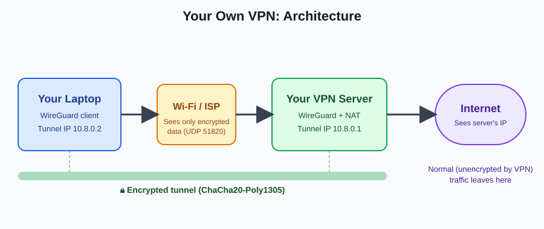
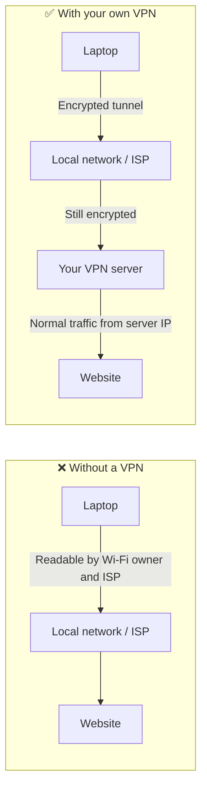
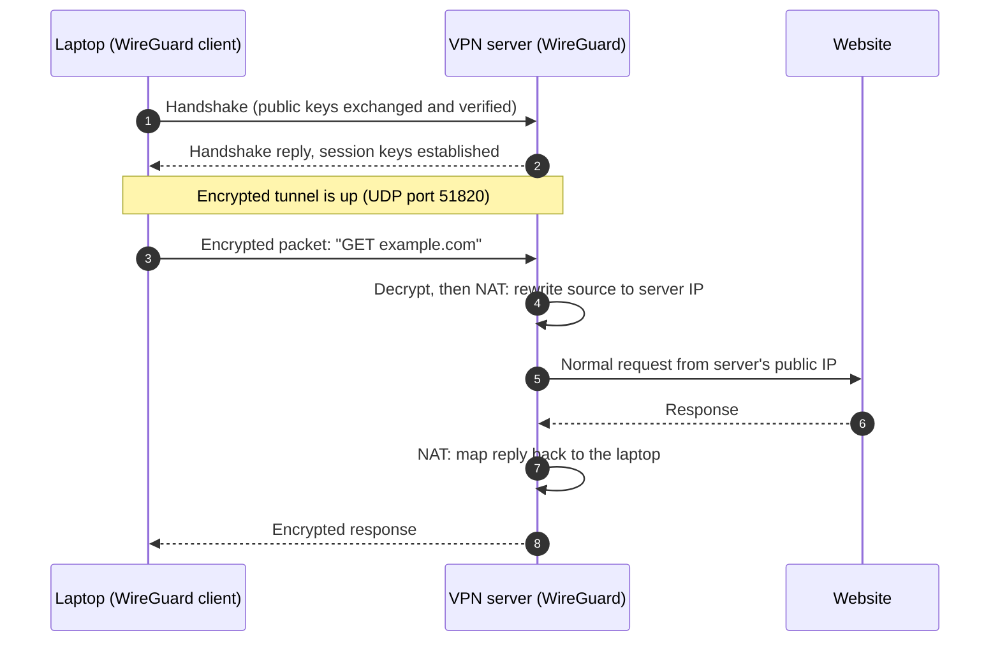
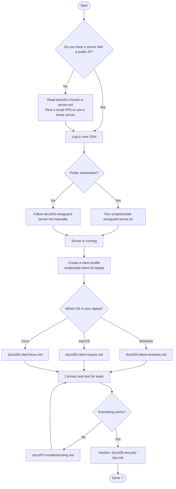
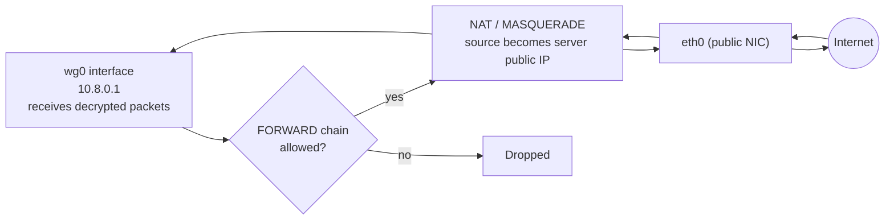
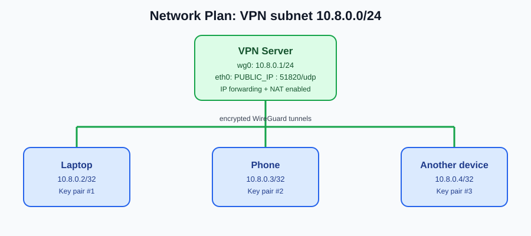

<div align="center">

# 🛡️ Set Up Your Own VPN

### A complete, beginner-to-confident guide to building a private WireGuard VPN on your own server and connecting your laptop to it.


**Author:** [Shivansh Kumar](https://shivanshonline.in) · **Portfolio:** [shivanshonline.in](https://shivanshonline.in)

</div>

---

## 📖 Table of Contents

1. [What is this project?](#-what-is-this-project)
2. [Why run your own VPN?](#-why-run-your-own-vpn)
3. [How it works (diagrams)](#-how-it-works)
4. [What you need](#-what-you-need)
5. [Quick start (about 15 minutes)](#-quick-start)
6. [Detailed guides](#-detailed-guides)
7. [Repository structure](#-repository-structure)
8. [Choosing a VPN protocol](#-choosing-a-vpn-protocol)
9. [Security checklist](#-security-checklist)
10. [Troubleshooting](#-troubleshooting)
11. [Limitations (be honest about what a VPN does)](#-limitations)
12. [FAQ](#-faq)
13. [Contributing](#-contributing)
14. [License and disclaimer](#-license-and-disclaimer)
15. [About the author](#-about-the-author)

---

## 🎯 What is this project?

This repository teaches you, step by step, how to **create and run your own VPN (Virtual Private Network)** instead of paying for a commercial service. You rent (or own) a small server, install **[WireGuard](https://www.wireguard.com/)** on it, and connect your laptop to it. All of your internet traffic then travels through an encrypted tunnel to your server and out to the internet from there.

You will learn:

- What a VPN really does, and what it does *not* do
- How to choose and prepare a server
- How to install and configure a WireGuard server (manually **and** with a script)
- How to connect **Windows, macOS, and Linux** laptops (plus phones)
- How to add, remove, and manage multiple devices
- How to test for leaks, harden the server, and troubleshoot problems

> 💡 **Who is this for?** Students, developers, and privacy-conscious users who are comfortable typing a few terminal commands. No networking background is required. Every concept is explained.

---

## 🤔 Why run your own VPN?

| | Commercial VPN | Your own VPN |
|---|---|---|
| **Who sees your traffic metadata** | The VPN company | Only you (and your hosting provider can see the server's traffic volume) |
| **Shared IP with strangers** | Yes | No, the IP is yours alone |
| **Cost** | Monthly subscription | Roughly the price of a small VPS |
| **Many country locations** | Yes | One location per server you create |
| **Setup effort** | None | ~15 minutes with this guide |
| **Learning value** | Low | High |
| **Streaming and anti-blocking** | Often tuned for it | Datacenter IPs may be blocked by some sites |

Good reasons to self-host: protecting yourself on public Wi-Fi, securely reaching your home network remotely, learning how networks and encryption work, and having a VPN with no third-party logging.

---

## 🧠 How it works

### 1. Big picture



Your laptop creates an **encrypted tunnel** to your VPN server. Websites only see the server's IP address, and anyone watching your local network (café Wi-Fi, ISP) only sees encrypted data going to the server.

### 2. Traffic flow without and with a VPN



### 3. What happens when you open a website



### 4. Setup flowchart (your journey through this repo)



### 5. Inside the server: how packets get out



This needs two things on the server: **IP forwarding** enabled in the kernel and a **NAT (masquerade) rule**. The provided script sets up both.

### 6. Addressing plan used in this guide



| Item | Value |
|---|---|
| VPN subnet | `10.8.0.0/24` |
| Server tunnel IP | `10.8.0.1` |
| First laptop | `10.8.0.2` |
| Second device | `10.8.0.3` (and so on) |
| WireGuard port | `51820/udp` |
| DNS pushed to clients | `1.1.1.1` (change if you prefer) |

---

## 🧰 What you need

**Server side**
- A Linux server with a **public IPv4 address**. Ubuntu 22.04/24.04 or Debian 12 are what the scripts target. A 1 vCPU / 512 MB–1 GB VPS is plenty.
- Root or `sudo` access over SSH
- UDP port `51820` reachable (open it in your provider's firewall panel too, if it has one)

**Client side**
- A laptop running Windows 10/11, macOS, or Linux
- The official WireGuard app (links in the client guides)

**Skills**
- Able to copy and paste commands into a terminal. That's it.

---

## ⚡ Quick start

> The full explanation of every step is in [`docs/03-wireguard-server.md`](docs/03-wireguard-server.md). This is the express route.

**1. On your server** (as root or with sudo):

```bash
git clone https://github.com/YOUR-USERNAME/setup-your-own-vpn.git
cd setup-your-own-vpn
sudo bash scripts/install-wireguard-server.sh
```

**2. Create a profile for your laptop** (still on the server):

```bash
sudo bash scripts/add-client.sh my-laptop
```

This prints a **QR code** (useful for phones) and saves the config to `/etc/wireguard/clients/my-laptop.conf`.

**3. Copy the profile to your laptop** securely:

```bash
# Run this on your laptop
scp youruser@SERVER_IP:/etc/wireguard/clients/my-laptop.conf .
```

(If the file isn't readable by your user, run `sudo cp` it to your home folder on the server first and `chown` it, then delete it afterwards.)

**4. Import and connect** using your OS guide: [Windows](docs/04-client-windows.md) · [macOS](docs/05-client-macos.md) · [Linux](docs/06-client-linux.md)

**5. Verify** by visiting an "what is my IP" site. It should show your **server's** IP, not your home IP. Then run the leak checks in [troubleshooting](docs/07-troubleshooting.md#testing-for-leaks).

---

## 📚 Detailed guides

| # | Guide | What it covers |
|---|---|---|
| 1 | [How VPNs work](docs/01-how-vpns-work.md) | Tunnels, encryption, keys, NAT, what a VPN does and doesn't hide |
| 2 | [Choose a server](docs/02-choose-a-server.md) | VPS vs home server, sizing, region, provider firewall, SSH basics |
| 3 | [WireGuard server setup](docs/03-wireguard-server.md) | Manual setup, every command explained |
| 4 | [Windows client](docs/04-client-windows.md) | Install the app, import the profile, connect |
| 5 | [macOS client](docs/05-client-macos.md) | App Store app and command-line method |
| 6 | [Linux client](docs/06-client-linux.md) | `wg-quick`, NetworkManager, auto-start |
| 7 | [Troubleshooting](docs/07-troubleshooting.md) | Handshake issues, no internet, DNS, MTU, leak tests |
| 8 | [Security tips](docs/08-security-tips.md) | SSH hardening, firewall, key rotation, updates |

---

## 🗂️ Repository structure

```
setup-your-own-vpn/
├── README.md                          ← you are here
├── LICENSE                            ← MIT
├── CONTRIBUTING.md
├── .gitignore                         ← keeps private keys out of Git
├── docs/
│   ├── 01-how-vpns-work.md
│   ├── 02-choose-a-server.md
│   ├── 03-wireguard-server.md
│   ├── 04-client-windows.md
│   ├── 05-client-macos.md
│   ├── 06-client-linux.md
│   ├── 07-troubleshooting.md
│   ├── 08-security-tips.md
│   └── images/
│       ├── architecture.svg
│       ├── network-plan.svg
│       └── handshake.svg
├── scripts/
│   ├── install-wireguard-server.sh    ← one-shot server installer
│   ├── add-client.sh                  ← create a client profile + QR
│   └── remove-client.sh               ← revoke a client
└── configs/
    ├── server.conf.example
    └── client.conf.example
```

---

## ⚖️ Choosing a VPN protocol

| Protocol | Speed | Setup difficulty | Code size | Best for |
|---|---|---|---|---|
| **WireGuard** (used here) | ⭐⭐⭐⭐⭐ | Easy | Very small, easy to audit | Almost everyone |
| OpenVPN | ⭐⭐⭐ | Moderate | Large | Legacy devices, TCP/443 fallback |
| IPsec / IKEv2 | ⭐⭐⭐⭐ | Moderate to hard | Large | Built-in OS clients |
| Tailscale / Headscale | ⭐⭐⭐⭐ | Very easy | n/a (built on WireGuard) | Connecting your own devices without a public server |

WireGuard is used here because it is fast, modern (current cryptography such as Curve25519 and ChaCha20-Poly1305), and the configuration fits on one screen.

---

## 🔐 Security checklist

- [ ] Private keys never leave the device that generated them and are **never committed to Git**
- [ ] Config files are `chmod 600`
- [ ] Only ports **22/tcp** (SSH) and **51820/udp** are open
- [ ] SSH uses keys, password login disabled
- [ ] Automatic security updates enabled
- [ ] One key pair **per device**
- [ ] Lost or stolen device? Remove its peer immediately with `remove-client.sh`
- [ ] Leak tests passed (IP, DNS, IPv6)

Details in [`docs/08-security-tips.md`](docs/08-security-tips.md).

---

## 🛠️ Troubleshooting

Quick reference (full version in [`docs/07-troubleshooting.md`](docs/07-troubleshooting.md)):

| Symptom | Likely cause | Fix |
|---|---|---|
| Connected but **no handshake** | UDP 51820 blocked, wrong endpoint IP, wrong public key | Open port in cloud firewall and `ufw`; recheck keys |
| Handshake works, **no internet** | IP forwarding or NAT rule missing | `sysctl net.ipv4.ip_forward` must be `1`; check masquerade rule |
| Websites load slowly or hang | MTU too high | Set `MTU = 1380` in the client `[Interface]` |
| Sites work by IP but not by name | DNS issue | Set `DNS =` in the client config |
| Real IPv6 address still visible | IPv6 leak | Disable IPv6 on client or tunnel it too |

---

## ⚠️ Limitations

A VPN is a useful tool, not magic. Being accurate matters:

- **It does not make you anonymous.** Your server provider knows who rents the server, and websites can still track you via cookies, logins, and browser fingerprinting.
- **It moves trust, it doesn't remove it.** You trust your hosting provider instead of your ISP.
- **A single server = a single location and a single IP** that is clearly a datacenter IP. Some services block those.
- **Maintenance is on you.** You must keep the server updated.
- **Follow the law.** Use it legally and respect your provider's terms of service.

---

## ❓ FAQ

**Is WireGuard free?** Yes, it's open source (GPL-2.0 for the kernel module and the tools).

**How much does the server cost?** Small VPS plans commonly cost a few US dollars a month; some providers have free tiers. Prices change, so check current offers.

**Can I connect my phone?** Yes. Use the official WireGuard app (iOS/Android) and scan the QR code that `add-client.sh` prints.

**Can several devices connect?** Yes. Run `add-client.sh` once per device. Each gets its own key and IP.

**Does it slow down my internet?** There's some overhead, and your speed is limited by the distance to the server and its bandwidth. WireGuard is among the fastest VPN protocols.

**Can I use it from behind a home router (no public IP)?** Self-hosting at home needs port forwarding and a dynamic DNS name, or a CGNAT-free connection. Covered in [`docs/02-choose-a-server.md`](docs/02-choose-a-server.md).

---

## 🤝 Contributing

Contributions are welcome: typo fixes, new OS guides, translations, better diagrams. See [`CONTRIBUTING.md`](CONTRIBUTING.md).

---

## 📜 License and disclaimer

Released under the **MIT License**. See [`LICENSE`](LICENSE).

This project is for **education and personal privacy**. You are responsible for following the laws of your country and the terms of your hosting provider. The author provides this material "as is" with no warranty.

---

## 👨‍💻 About the author

<div align="center">

### **Shivansh Kumar**

🌐 **Portfolio:** [shivanshonline.in](https://shivanshonline.in)

*If this repo helped you, please ⭐ star it and share it with someone who wants to learn networking.*

</div>
