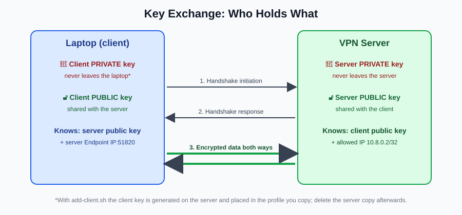

# 1. How VPNs Work

*Part of [Set Up Your Own VPN](../README.md) by [Shivansh Kumar](https://shivanshonline.in)*

## What is a VPN?

A **Virtual Private Network** creates an encrypted connection (a *tunnel*) between your device and another computer (the *VPN server*). Your internet traffic goes through that tunnel, and the server forwards it to the internet on your behalf.

## Key concepts

| Term | Plain-English meaning |
|---|---|
| **Tunnel** | Your packets are wrapped (encapsulated) inside other, encrypted packets. |
| **Encryption** | Scrambling data so only the holder of the right key can read it. |
| **Public / private key** | A matched pair. The public key can be shared, the private key must stay secret. |
| **Peer** | Either end of a WireGuard connection (client or server). |
| **Endpoint** | The public `IP:port` where a peer can be reached. |
| **AllowedIPs** | Which IP addresses are routed through the tunnel *and* accepted from that peer. |
| **NAT / masquerade** | The server rewrites packets so the internet sees the server's IP. |
| **UDP** | The transport WireGuard uses. Fast, connectionless. |

## What WireGuard does

1. Each side has a key pair.
2. You tell each side the other's **public** key.
3. When the client sends its first packet, the two sides do a cryptographic handshake and derive fresh session keys (these are rotated regularly).
4. Data flows encrypted. WireGuard is silent when idle, which saves battery and makes it stay quiet on networks.

## What a VPN protects you from

- Other people on the same Wi-Fi (cafés, hotels, airports) reading or tampering with your unencrypted traffic
- Your ISP seeing which sites you visit (it still sees that you connect to your server)
- Websites seeing your real home IP address

## What a VPN does NOT do

- Make you anonymous. Logins, cookies, and browser fingerprints still identify you.
- Protect you from malware or phishing.
- Hide you from your **VPS provider**, who can see traffic leaving the server.
- Encrypt traffic **after** it leaves the server. Use HTTPS as well.

## Why WireGuard?

- Roughly 4,000 lines of code in the Linux kernel module, which makes it far easier to audit than older VPNs
- Modern cryptography: Curve25519, ChaCha20-Poly1305, BLAKE2s
- Built into the Linux kernel (5.6+)
- Very fast connect and reconnect times

Next: [2. Choose a server](02-choose-a-server.md)
