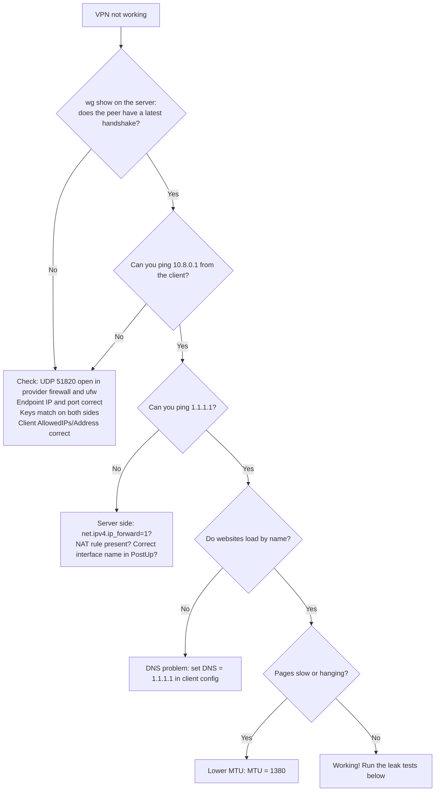

# 7. Troubleshooting

*Part of [Set Up Your Own VPN](../README.md) by [Shivansh Kumar](https://shivanshonline.in)*

## Decision tree



## Server-side checks

```bash
sudo wg show                                  # handshake and transfer counters
sysctl net.ipv4.ip_forward                    # must be 1
sudo iptables -t nat -S POSTROUTING           # look for MASQUERADE
sudo iptables -S FORWARD | head               # look for wg0 ACCEPT rules
sudo ss -ulpn | grep 51820                    # is WireGuard listening?
sudo journalctl -u wg-quick@wg0 --no-pager | tail -30
```

Watch live traffic arriving at the server:

```bash
sudo tcpdump -ni any udp port 51820
```

If nothing appears when the client connects, the packets are being blocked before the server (provider firewall, wrong IP, or your local network blocking UDP).

## Client-side checks

```bash
ping 10.8.0.1          # the server inside the tunnel
ping 1.1.1.1           # internet by IP
ping example.com       # internet by name (tests DNS)
```

## Common causes

| Symptom | Cause | Fix |
|---|---|---|
| No handshake | Port blocked | Allow `51820/udp` in provider panel and `ufw` |
| No handshake | Mismatched keys | Re-check that each side has the *other's public* key |
| Handshake OK, nothing loads | Forwarding or NAT missing | Steps 3, 5 of [server setup](03-wireguard-server.md) |
| `PostUp` fails | Wrong interface name | Use the name from `ip -4 route show default` |
| Names don't resolve | No DNS in tunnel | Add `DNS = 1.1.1.1` to client |
| Slow or stalls | MTU | `MTU = 1380` (try 1280 if still bad) |
| Works on one network only | Network blocks UDP | Try another network or port (e.g. 443/udp) |
| Drops when idle behind NAT | No keepalive | `PersistentKeepalive = 25` |

## Testing for leaks

1. **IP test:** a "what is my IP" site should show your **server's** IP, not your home IP.
2. **DNS leak test:** use a DNS leak test site (search "DNS leak test") and confirm it does not list your ISP's DNS servers.
3. **IPv6 test:** the guide's default `AllowedIPs = 0.0.0.0/0` only tunnels IPv4. If a test shows your real IPv6 address, either disable IPv6 on your laptop or tunnel IPv6 too (needs IPv6 set up on the server). See the section below.
4. **WebRTC:** browsers can reveal local addresses; check with a WebRTC leak test and adjust browser settings if needed.

## Disabling IPv6 on the client (simple fix for IPv6 leaks)

- **Linux:** `sudo sysctl -w net.ipv6.conf.all.disable_ipv6=1`
- **Windows:** Network adapter properties → untick *Internet Protocol Version 6 (TCP/IPv6)*
- **macOS:** `networksetup -setv6off Wi-Fi` (replace `Wi-Fi` with your service name from `networksetup -listallnetworkservices`)

## Still stuck?

Open an issue with: your OS, server OS, the output of `sudo wg show` (**remove keys**), and what you tried. Never paste private keys.
